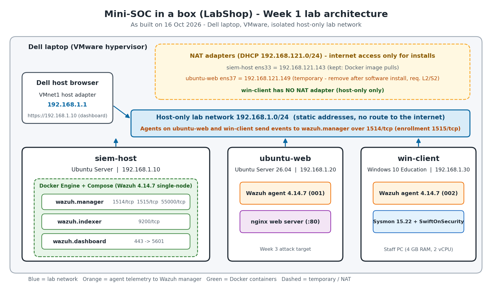

# LabShop SOC lab - Week 1: build the lab and deploy Wazuh

Mini-SOC in a box, Blue Team Capstone, Week 1. Author: Aytac Dəmirova. Lab work: 16-19 October 2026.

LabShop is a small online shop with one web server and one staff PC, and no security monitoring. Week 1 builds an isolated virtual lab and deploys Wazuh, which collects what the machines say. The full report with all figures is in `report/Aytac_lab_report.docx`.

## Versions

| Component | Version |
|---|---|
| Wazuh (manager, indexer, dashboard, agents) | **4.14.7**, single-node, Docker Compose |
| Docker Engine | 29.9.1 (official Docker apt repository) |
| Docker Compose plugin | v5.6.0 |
| Sysmon (win-client) | 15.22 with the SwiftOnSecurity configuration |
| nginx (ubuntu-web) | 1.28.3 |
| Hypervisor | VMware Workstation (hardware compatibility 25H2) on a Dell laptop |
| ubuntu-web OS | Ubuntu Server 26.04 LTS |
| win-client OS | Windows 10 Education 10.0.19045.6456 |

## Architecture

| Machine | Role | Host-only IP | RAM | vCPU | Disk | Adapters |
|---|---|---|---|---|---|---|
| siem-host | Wazuh in Docker | 192.168.1.10 | 16 GB | 8 | 250 GB | VMnet8 (NAT) + VMnet1 (host-only) |
| ubuntu-web | Linux endpoint, nginx | 192.168.1.20 | 2 GB | 2 | 40 GB | VMnet1 only |
| win-client | Windows endpoint, Sysmon | 192.168.1.30 | 4 GB | 2 | 60 GB | VMnet1 only |

The lab network is host-only (VMnet1, 192.168.1.0/24, static addresses, Dell = 192.168.1.1). Only siem-host has a NAT adapter, for Docker image pulls, so no other VM has a route to the internet. More in `architecture/address-table.md`.

## Start and stop the whole lab (in this order)

**Start**

1. Open VMware on the Dell and power on **siem-host**.
2. Log in on siem-host and check the Wazuh containers: `cd ~/wazuh-docker/single-node && docker compose ps`. After a reboot the three containers (wazuh.indexer, wazuh.manager, wazuh.dashboard) come back by themselves. If one is not Up, run `docker compose start`.
3. Open https://192.168.1.10 from the Dell and wait until the login page appears (the browser warns about the certificate, see below). Log in as `admin`.
4. Power on **ubuntu-web**, then **win-client**.
5. In the dashboard, open Endpoints and check that both agents are **Active (2)**.

**Stop**

1. Shut down **win-client**, then **ubuntu-web**.
2. On siem-host run `cd ~/wazuh-docker/single-node && docker compose stop`, then `sudo shutdown now`.
3. Never run `docker compose down -v`: it deletes the volumes, including agents and alerts. Use only `stop` and `start`.

Take a VM snapshot before starting each week and another when it is finished (Week 1: `w1-clean-install` and `w1-done` on all three VMs).

## Persistence test (W4)

`docker compose stop` and `docker compose start`, and a reboot of siem-host (`sudo reboot`), keep the agents and the alerts. After the reboot the three containers were already Up without any command, and I only had to log in to the dashboard again. Agents: Active (2) after both tests. The 18 sshd alerts of 16 October were still stored. Figures 27 to 36 in the report.

## Idle memory per Wazuh container (W5)

Measured with `docker stats --no-stream` about six minutes after the first start, before any agent was enrolled (Docker limit 15.07 GiB).

| Container | Memory | % of limit |
|---|---|---|
| single-node-wazuh.dashboard-1 | 203.8 MiB | 1.32% |
| single-node-wazuh.manager-1 | 744.3 MiB | 4.82% |
| single-node-wazuh.indexer-1 | 1.515 GiB | 10.06% |
| **Total** | **about 2.44 GiB** | about 16% |

## Dashboard certificate warning (W2)

The dashboard uses TLS, but its certificate comes from Wazuh's own certificate generator. It is signed by a lab root CA that the browser does not trust, and it is issued for the container name, not for 192.168.1.10. The traffic is encrypted, but the browser cannot verify the server, so it shows "Not secure". In this isolated lab I accept the warning; in production I would use a certificate from a trusted CA.

## Five deliberate events (V1)

| # | Event | Rule description | Level | Rule ID | Screenshots (`evidence/`) |
|---|---|---|---|---|---|
| 1 | Failed SSH login | sshd: authentication failed. | 5 | 5760 | `fig48-terminal-on-the-dell-several-permission.png`, `fig49-alert-details-agent-ubuntu-web-srcip.png`, `fig50-rule-fields-rule-id-5760-rule.png` |
| 2 | Command run with sudo | Successful sudo to ROOT executed. | 3 | 5402 | `fig51-terminal-on-ubuntu-web-failed-sudo.png`, `fig52-alert-details-data-command-usr-bin.png`, `fig53-rule-fields-rule-description-successful-sudo.png` |
| 3 | New local user on Linux | New user added to the system. | 8 | 5902 | `fig54-alert-details-useradd-created-testuser1-uid.png`, `fig55-rule-fields-rule-description-new-user.png` |
| 4 | Program started on Windows (Sysmon) | Discovery activity executed | 3 | 92031 | `fig56-sysmon-event-data-commandline-net1-user.png`, `fig57-system-fields-channel-microsoft-windows-sysmo.png`, `fig58-rule-fields-discovery-activity-executed-rule.png` |
| 5 | Failed Windows logon | Logon Failure - Unknown user or bad password | 5 | 60122 | `fig59-query-data-win-system-eventid-4625.png`, `fig60-event-data-logontype-2-status-0xc000006d.png`, `fig61-rule-fields-rule-description-logon-failure.png` |

## Path of one event from the endpoint to the alert (V2)

Example: a failed SSH login on ubuntu-web.

1. sshd writes "Failed password for ubuntu from 192.168.1.1" to the system journal.
2. The Wazuh agent (logcollector) reads the journal. On Windows the agent reads event channels (Security and Sysmon).
3. The agent sends the event, encrypted, to the manager at 192.168.1.10 on port 1514/tcp. The agent was registered earlier through port 1515.
4. In the wazuh.manager container the sshd decoder splits the line into fields, and rule 5760 matches it with level 5.
5. The manager writes an alert with the fields, the MITRE mapping and the compliance tags.
6. Filebeat in the manager container ships the alert to wazuh.indexer (port 9200), into the daily index `wazuh-alerts-4.x-YYYY.MM.DD`.
7. wazuh.dashboard queries the indexer and shows the alert in Discover and on the agent pages (https://192.168.1.10, port 443).

Short form: endpoint log -> agent -> manager (decoder + rules) -> alert -> Filebeat -> indexer -> dashboard.

## Security notes (S1, S2, W3)

- `.gitignore` keeps `*.pem`, `*.key` and `.env` out of this repository, and `git ls-files | grep -E "pem|key|env"` returns nothing.
- The Wazuh deployment (certificates, `docker-compose.yml` with the passwords in plain text) lives in `~/wazuh-docker` on siem-host, outside this repository. No password, key or certificate is stored here, and there is no screenshot of `docker-compose.yml` in `evidence/`.
- The default administrator password was changed with `securityadmin.sh` inside the indexer container (Clusterstate GREEN, "Done with success").
- Isolation: only siem-host has a NAT adapter. ubuntu-web lost its NAT adapter after the software installation, and win-client has none.

## Windows expiry date

`slmgr /xpr` on win-client answers "Windows is in Notification mode" (report figure 19). The installation is not activated and has no expiry date, so the lab does not depend on one.

## Repository layout

| Path | Content |
|---|---|
| `README.md` | This file |
| `architecture/` | `lab-diagram.png` (my own diagram) and `address-table.md` |
| `evidence/` | One screenshot per report figure, and `INDEX.md` |
| `journal.md` | Journal of the week: what I tried, what failed, what fixed it |
| `report/` | The Week 1 report (`Aytac_lab_report.docx`) |
